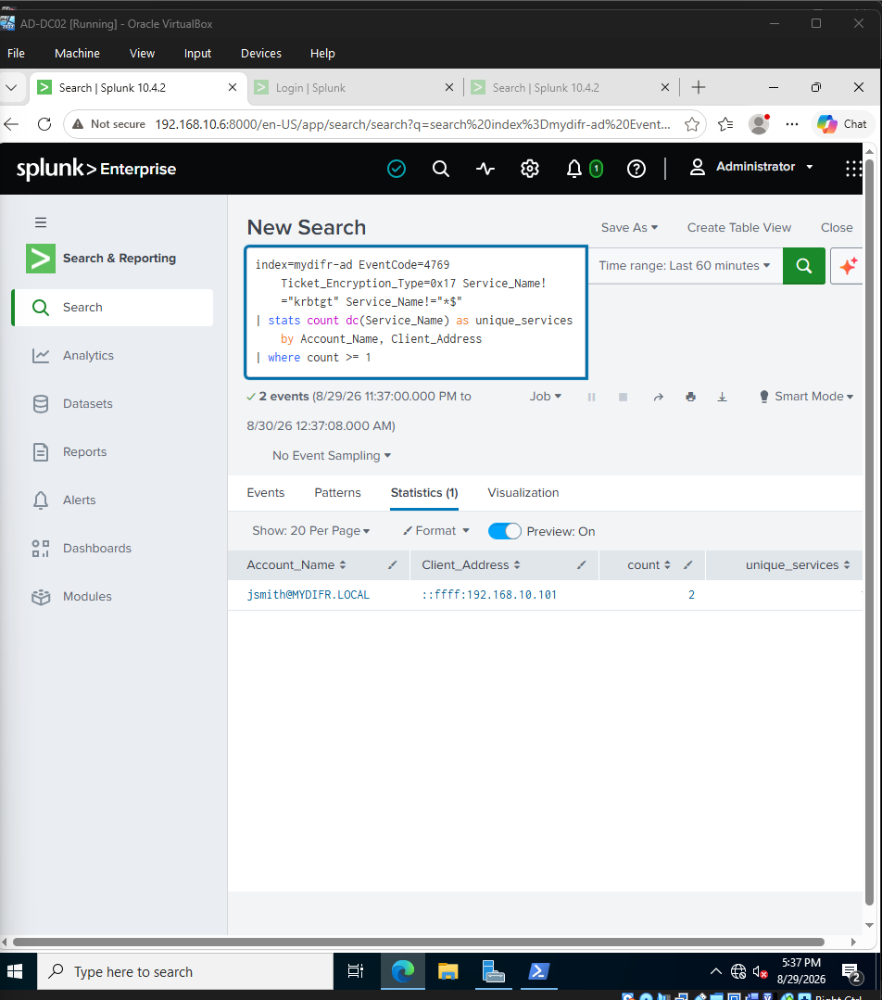
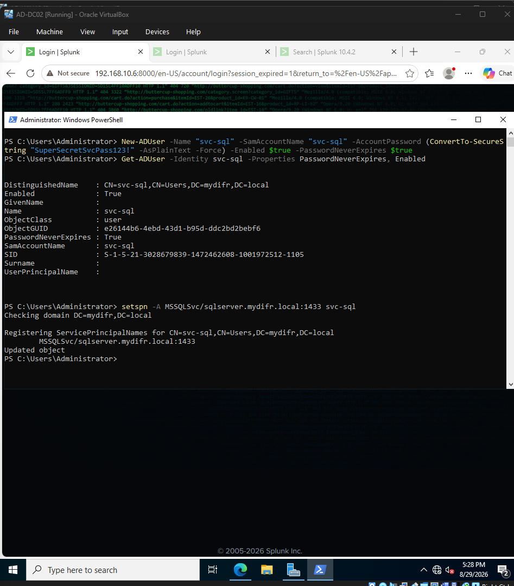
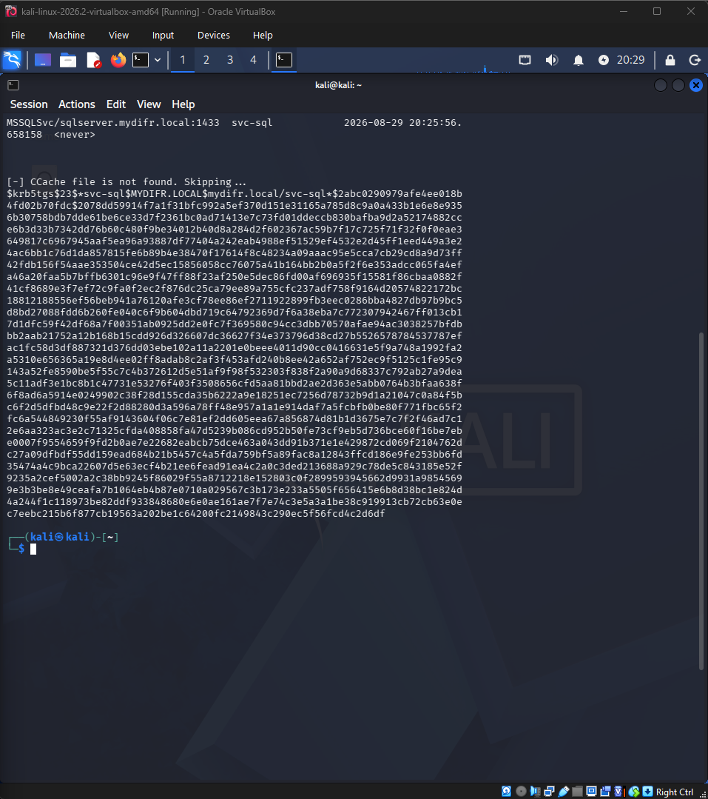
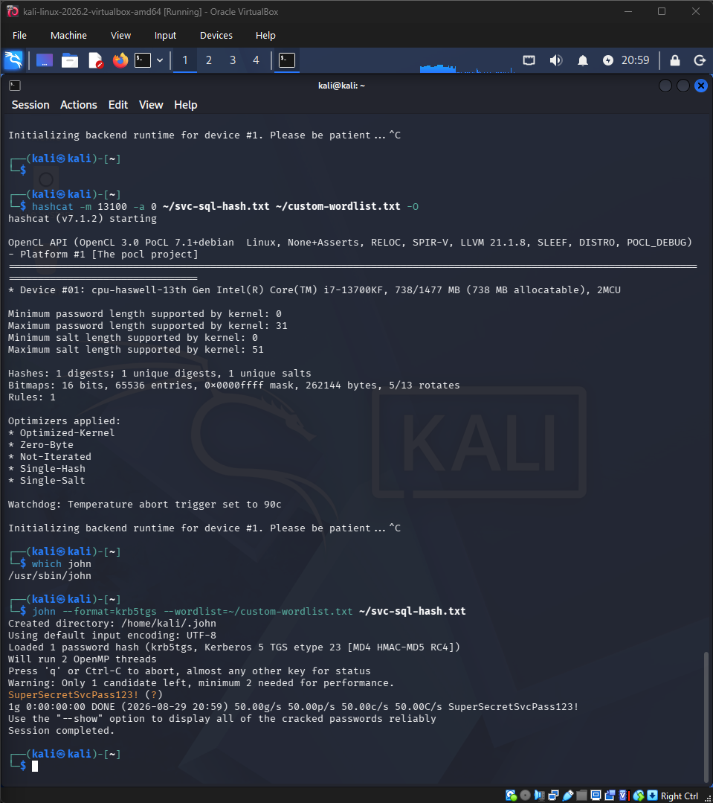
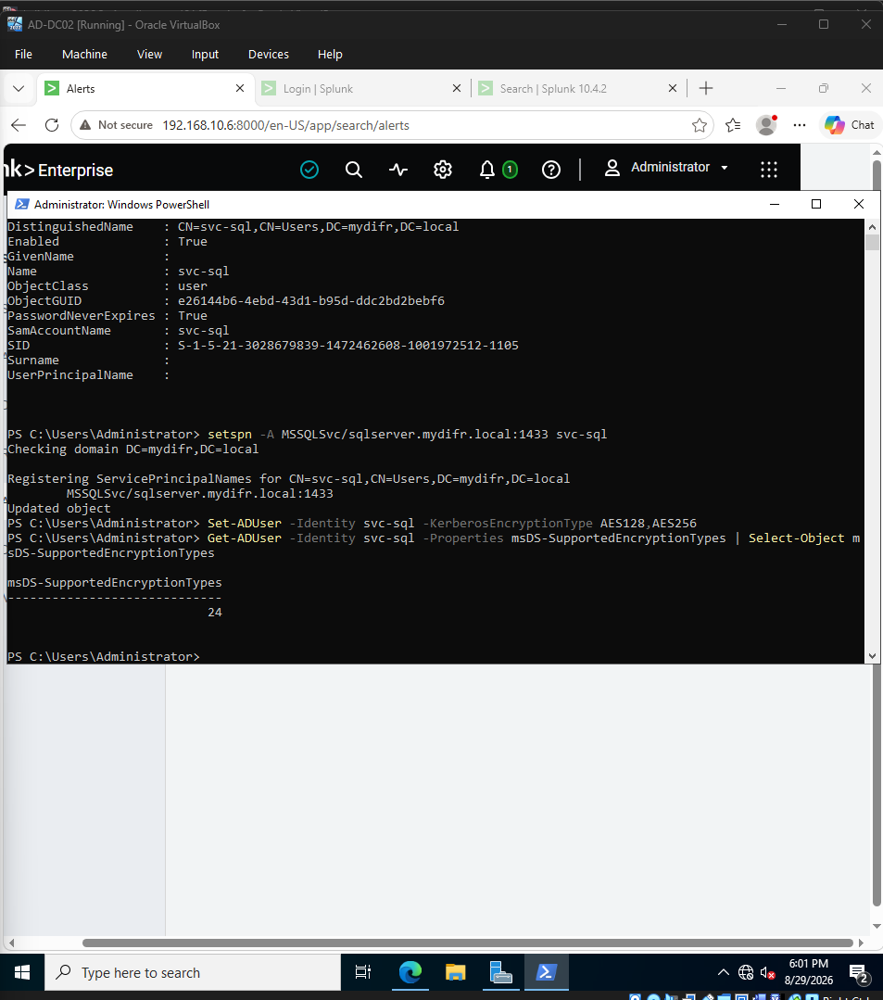
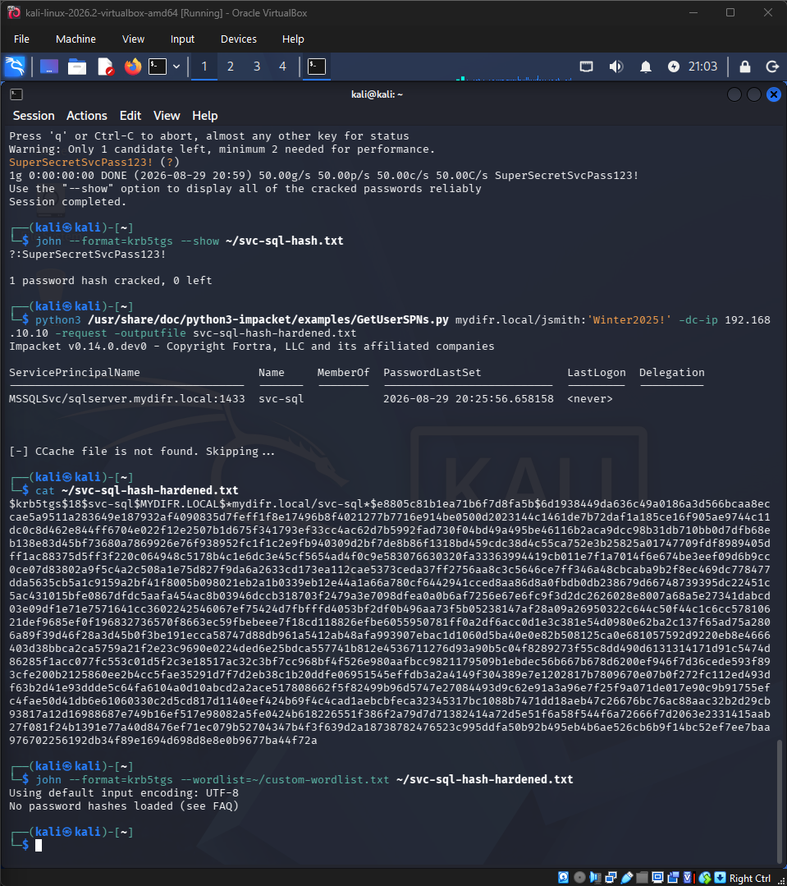

# Active Directory Home Lab with Splunk SIEM and SOAR Automation

I built a small Active Directory network in VirtualBox, attacked it in two stages (password brute force, then Kerberoasting), wrote Splunk detections that caught both attacks on real event data, hardened the targeted account, and built an automated alerting and response workflow with Shuffle SOAR.

Built on MYDFIR's *Active Directory Project 2.0* series, then extended with a second attack stage, two original detections, an encryption-hardening test, and a redesigned response workflow (see [What I added](#what-i-added-beyond-the-tutorial)).

---

## Results at a glance

| What | Outcome |
|---|---|
| Brute-force detection (Event 4625) | ✅ Fired on real failed RDP logins |
| Unauthorized logon detection (Event 4624) | ✅ Fired on the attacker's successful login |
| Kerberoasting detection (Event 4769) | ✅ Isolated the attacker's RC4 ticket request from normal traffic |
| Kerberoasting attack | ✅ Service ticket dumped and password cracked |
| RC4 → AES hardening | ✅ Account now issues AES tickets only; the same cracking tool could no longer process the ticket |
| Shuffle SOAR workflow | ✅ Ran end to end (Slack + email), ⚠️ alert messages don't yet include incident details |
| IP-block response script | ✅ Works when run manually, ⚠️ Splunk-triggered version blocked by a platform permission issue |
| Account disable | ⚠️ Manual analyst step (cloud SOAR couldn't reach the domain controller) |

**Skills shown:** Active Directory administration, Splunk SPL, Sysmon, Windows event analysis, detection tuning, Kerberos attacks and hardening, SOAR workflow design, Windows OpenSSH, troubleshooting.

---

## Environment

All VMs run locally in VirtualBox on a NAT Network (`192.168.10.0/24`).

| VM | Role | IP | OS / Specs |
|---|---|---|---|
| AD-DC02 | Domain controller (`mydifr.local`) | 192.168.10.10 | Windows Server 2022, 4 GB RAM |
| AD-WIN10 | Domain-joined workstation | 192.168.10.100 | Windows 10 Pro, 6 GB RAM |
| Splunk-SVR | SIEM | 192.168.10.6 | Ubuntu Server 24.04, 6 GB RAM |
| Kali | Attacker | 192.168.10.101 (static) | Kali rolling |

**Logging:** Splunk Universal Forwarder on both Windows machines sends Security, System, and Application logs plus Sysmon (SwiftOnSecurity config) to the `mydifr-ad` index.

**Accounts:** `jsmith` (standard domain user, the brute-force target), `svc-sql` (service account, the Kerberoasting target), and `localadmin` (local admin on the workstation). All passwords shown in this writeup are lab-only.

> The domain is spelled `mydifr.local` instead of `mydfir.local` because of a typo during DC promotion. I kept it rather than demote and re-promote, and kept all later config consistent with it.

---

## Attack chain

```
Brute force (T1110)            →  jsmith's password recovered
        ↓
Kerberoasting (T1558.003)      →  jsmith's access used to steal and crack svc-sql's password
```

I chained the two attacks on purpose: real compromises usually escalate from initial access to further credential theft, rather than happening as isolated techniques.

---

## Detections

All three queries were tested against real attack data. Every field name was checked by expanding a real captured event, which turned out to matter (see [Lessons learned](#lessons-learned)).

### 1. Unauthorized successful logon (Event 4624)

```spl
index=mydifr-ad EventCode=4624
(Source_Network_Address=* AND Source_Network_Address!="-"
 AND NOT (Source_Network_Address="192.168.10.10" OR Source_Network_Address="192.168.10.100"))
| stats count by _time, ComputerName, Source_Network_Address, user, Logon_Type
```

The base tutorial flagged public IPs, but this lab is fully internal, so I used an allowlist of the two legitimate hosts instead. Any successful logon from anywhere else is flagged.

### 2. Brute force within a time window (Event 4625)

```spl
index=mydifr-ad EventCode=4625 LogName=Security
| sort 0 _time
| streamstats time_window=90s count as recent_failures by user, src_ip
| where recent_failures >= 5
```

A rolling window separates rapid guessing from slow background noise, like an old cached password retrying every few hours.

- `sort 0 _time` is required: `streamstats` needs oldest-first order, and Splunk returns newest-first by default.
- The threshold is `>= 5` because my test generated exactly 5 failures, so `> 5` could never fire.
- The 90-second window fits my manual test (5 attempts over 51 seconds). Against real automated tools, I'd tighten it to about 10 seconds.

### 3. Kerberoasting (Event 4769)

```spl
index=mydifr-ad EventCode=4769 Ticket_Encryption_Type=0x17 Service_Name!="krbtgt" Service_Name!="*$"
| stats count dc(Service_Name) as unique_services by Account_Name, Client_Address
| where count >= 1
```

Modern domains normally use AES (`0x12`) for Kerberos tickets. A request for an RC4 (`0x17`) ticket for a real service account, rather than a machine account, is the signature of a Kerberoasting tool.

The threshold of 1 matches what I tested (one targeted service account). In production I'd raise it to about 3 or more distinct services, to catch one account requesting tickets for many services while ignoring one-off requests.



---

## Attack walkthrough

### Phase 1: Brute force over RDP

I first tried Hydra's RDP module. It found the password but **created no Windows logon events** (I confirmed this directly in Event Viewer). The module is marked experimental and appears to check credentials without completing a full logon.

So I used manual `xfreerdp` connections, which create real events:

```bash
xfreerdp /v:192.168.10.100 /u:jsmith /p:'<password>' /cert:ignore
```

Five wrong passwords produced five 4625 events, and the correct password produced one 4624 event (Logon Type 10, from 192.168.10.101). **Both detections fired.**

Getting RDP to accept any login took two separate steps: enabling Remote Desktop (as `localadmin`, because `jsmith` lacks the rights), then adding `jsmith` to the local Remote Desktop Users group.

### Phase 2: Kerberoasting

**Setup.** I created a service account with a non-expiring password and registered a fake SQL Server SPN, the way real service accounts are often set up:

```powershell
New-ADUser -Name "svc-sql" -SamAccountName "svc-sql" -AccountPassword (ConvertTo-SecureString "SuperSecretSvcPass123!" -AsPlainText -Force) -Enabled $true -PasswordNeverExpires $true
setspn -A MSSQLSvc/sqlserver.mydifr.local:1433 svc-sql
```



**Attack.** Using `jsmith`'s stolen credentials, Impacket requested a service ticket for every account with an SPN:

```bash
python3 /usr/share/doc/python3-impacket/examples/GetUserSPNs.py mydifr.local/jsmith:'Winter2025!' -dc-ip 192.168.10.10 -request -outputfile svc-sql-hash.txt
```

The ticket came back as `$krb5tgs$23$...`. The `23` means RC4 encryption, which can be cracked offline.



**Cracking.** hashcat wouldn't run in the VM (no GPU, and the CPU-only OpenCL runtime was far too slow), so I switched to John the Ripper, which runs natively on CPU:

```bash
john --format=krb5tgs --wordlist=<wordlist> svc-sql-hash.txt
```

The password cracked instantly against a targeted wordlist.



### Phase 3: Hardening (RC4 → AES)

I restricted the service account to AES encryption only:

```powershell
Set-ADUser -Identity svc-sql -KerberosEncryptionType AES128,AES256
```

`msDS-SupportedEncryptionTypes` read `24` (AES128 + AES256), confirming RC4 was removed.



When I reran the same attack, the ticket came back as `$krb5tgs$18$` (AES256) instead of `$23$` (RC4). John, with the same wordlist containing the real password, returned **"No password hashes loaded"**, so it couldn't process the AES ticket at all.

**What this proves and what it doesn't:** the hardening worked, and the account now only issues AES tickets, so the attack that broke the RC4 ticket no longer works. AES tickets are much harder to crack than RC4, but I didn't test a cracking attempt with a tool configured for AES.



---

## Automated response (SOAR)

Splunk alerts trigger a Shuffle workflow through a webhook. Each alert gets a different response level based on how risky an automated action would be.

### Unauthorized logon → notify and request approval

```
Splunk alert → Shuffle webhook → Slack (#alerts)
                                    ├── FYI email to the account holder
                                    └── Approval email asking the SOC analyst to review and disable the account
```

**Original plan:** after the analyst approves, Shuffle disables the account over LDAP automatically.

**What changed:** Shuffle's cloud service only allows outgoing HTTP/HTTPS. I tested an LDAP connection through a working ngrok tunnel, and the tunnel never saw a single connection. So the analyst now disables the account manually (`Disable-ADAccount -Identity jsmith`). The human approval step stays the same. Only who carries out the disable changed.

**Known gap:** the Slack and email messages arrive, but the account, source IP, and time fields are blank. I never mapped the template to Shuffle's runtime variables. This is an operational gap, because an analyst needs those details to act, and it's the next thing to fix.

### Brute force → block the attacker's IP

I wrote a script on the Splunk server (`ip_ban.sh`) that connects to the workstation over key-based SSH and adds a Windows Firewall rule blocking the attacker's IP.

- **Working:** running it manually created and then removed a real block rule (confirmed with `Get-NetFirewallRule`).
- **Blocked:** when Splunk's "Run a script" alert action triggers it, the script fails (exit code 1). Splunk's internal logs (`index=_internal ip_ban`) showed that the results file sits in a `root`-only directory that the `splunk` user can't read. Splunk marks this alert action as deprecated. Instead of loosening permissions on Splunk's internal folders, I documented it. The proper fix is a packaged custom alert action.

### Kerberoasting → manual investigation only

There's no automated response. Rotating a service account's password automatically could break a live service that still uses the old password, so that decision is left to a person.

---

## Design decisions

- **Account disable needs approval, IP block doesn't.** Disabling the wrong account locks a real employee out of everything. Blocking an IP is low impact and easy to undo.
- **The account holder is notified in parallel, not as a gate.** Waiting on them would slow containment, and their inbox may be compromised.
- **Hardening is separate from detection.** Detection reacts after an attack. Removing RC4 prevents this specific attack.
- **Documented limits instead of fragile workarounds.** For both the Shuffle and Splunk blockers, I documented the root cause and the correct production fix rather than adding workarounds around platform restrictions.

---

## What I added beyond the tutorial

- A second attack stage (Kerberoasting), plus the RC4 → AES before/after test
- Two original detections: the time-windowed brute-force alert and the Kerberoasting alert
- An allowlist-based logon detection, which fits a fully internal network
- Sysmon on both Windows hosts
- Local VirtualBox build with a dedicated Kali attacker, instead of a cloud VM
- An IP-block response built on the Splunk side instead of through SOAR
- Slack Incoming Webhooks instead of Shuffle's Slack app, whose OAuth kept failing

---

## Lessons learned

**Verify Splunk field names against a real event every time.** The source IP field was named differently for each event type: `Source_Network_Address` (4624), `src_ip` (4625), and `Client_Address` (4769, where `IpAddress` was blank). A wrong name returns zero results with no error. This took more debugging time than anything else in the project.

**Check the basics before assuming something complex is broken.**
- After long saved-state pauses, the VM clocks had drifted by about 4 hours, which silently broke alert scheduling. Fixed with `timedatectl set-ntp true`.
- An alert fired every minute for 20 minutes with no effect because the Shuffle webhook trigger was still set to "stopped."
- Kali could ping IPs but not resolve hostnames because `/etc/resolv.conf` had no nameserver.
- Kali's DHCP lease collided with Splunk's static IP, so I gave Kali a static address.

**Windows details that aren't obvious:**
- RDP needs both the feature enabled and the user in the Remote Desktop Users group.
- Windows OpenSSH reads admin keys from `C:\ProgramData\ssh\administrators_authorized_keys`, not the user's `.ssh` folder, and ignores the file if its permissions are too open.

**Tools don't always do what you assume.** Hydra's RDP module found the password but created no logs. hashcat couldn't run without a GPU, so I switched to John.

---

## Future work

- Fill in the Slack and email templates with the real incident details
- Rebuild the IP block as a packaged Splunk custom alert action
- Correlate the brute-force and successful-logon alerts into one higher-confidence alert
- Self-host Shuffle inside the lab so it can reach the domain controller directly
- Add detections for lateral movement, PowerShell abuse, and pass-the-ticket
- Design a safe, service-aware way to rotate service account passwords
